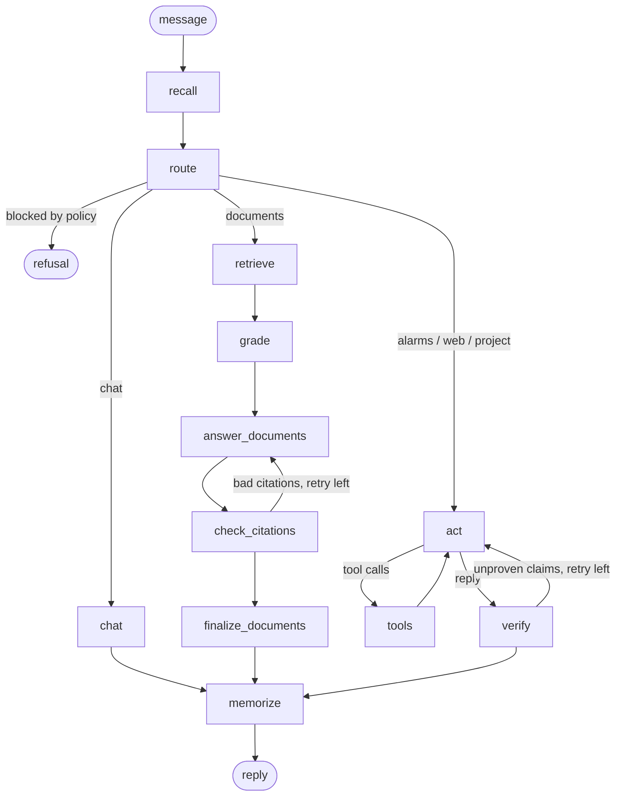

# Aroa Assistant

A law firm's assistant that runs entirely on the firm's own machine. It is built as an explicit
**LangGraph** state machine with **RAG memory** walled by matter, **pseudonymisation** of personal
data before any model call, a **policy gate**, **claims verified in code**, and **observability**
built in (OpenTelemetry traces, per-turn metrics, audit log, a plain-language path for every reply,
evals). Local models through Ollama or any OpenAI-compatible gateway; Anthropic if you want it.

```text
$ uv run aroa ask -v --matter 2026-014 "El director financiero del cliente es Pedro Sanz, DNI 44556677K, \
  y prefiere un acuerdo antes que ir a juicio. ¿Qué dice la hoja de encargo si hay acuerdo?"
· Recall: Personal data in the message was replaced by placeholders. Nothing relevant in memory.
· Route: documents. Query: «honorarios en caso de acuerdo, hoja de encargo expediente 2026/014»
· Search documents (0.4s): 6 fragments from 3 documents (hybrid search, 2 queries).
· Keep what helps (2.4s): 3 of 6 fragments kept.
· Answer from documents (7.2s): Coverage full, 1 citation.
· Check citations: Every quote appears verbatim in its fragment.
· Memorize (5.4s): 2 new facts stored, 0 already known.
    - stored · [PERSON_2] es el director financiero de [ORG_8].
    - stored · [ORG_8] prefiere resolver el asunto mediante acuerdo antes que ir a juicio.

Si el asunto se resuelve mediante acuerdo, los honorarios se reducen a 1.800 euros más IVA [1].

**Sources**
- [1] Hoja de encargo profesional — Expediente 2026/014 — Cláusula 2. Honorarios (`hoja_de_encargo_honorarios.md`)
  > «Si el asunto se resuelve mediante acuerdo antes de la vista, los honorarios se reducirán a 1.800 euros más IVA.»
```

The model saw `[PERSON_2]` and `[ORG_8]`, never "Pedro Sanz" or the DNI; the lawyer sees the real
names because the interface restores them. The facts stored in memory carry the matter `2026-014`
and are never recalled while working on another matter.

## What it does

| | |
|---|---|
| **Converses and remembers** | Facts are extracted from every turn, deduplicated and stored with the matter they were learned in. Recall is hybrid (dense + BM25) over facts, past episodes and documents. |
| **Answers from the firm's documents** | Corrective RAG with `[n]` citations and verbatim quotes, both verified in code; abstains when the documents do not answer. Prompt injection inside a document cannot become a cited fact. |
| **Deadlines are arithmetic, not opinion** | When a term ends is computed in code from the notification date, the jurisdiction and the firm's holiday calendar (working days, August, the Christmas break, months date-to-date, the 15:00 grace of art. 135.5 LEC). The model asks the tool and relays the result; the reply lists every excluded day and the rule behind it. |
| **Citations are checked before anything is filed** | Every article, law or judgment cited in a draft is extracted with patterns and verified in code against the firm's own archive of the BOE (consolidated legislation, with the date the text was fetched): the norm exists, the article exists, here is its current text and official link, or a plain «no existe». Judgments are flagged as not automatically verifiable. |
| **Long documents, whole** | A document of any length is read fragment by fragment, findings are merged in code (repeats folded, every location kept) and nothing is reported without a verbatim quote that opens where it came from. Runs as a background job with progress; the model-written overview is kept only if every sentence cites a finding. |
| **The review pass** | A draft is checked in a separate job: repeated paragraphs, quotes that are not verbatim in the documents (with the original as the fix), citations against the BOE archive (inexistent article, wrong article number corrected when the quoted text sits elsewhere). The model only points at legal issues, as warnings, and only where it quotes the draft. Changes are accepted or rejected one by one. |
| **Editor** | Documents are edited in the app with a Word-like editor (served locally, no CDN): headings, lists, tables, find and replace, versions on every save, export to `.docx`, import of `.docx`. A chat answer or the corrected draft of a review opens in the editor with one click. |
| **Untrusted content is quarantined** | Documents, tool results, pages, attachments and memory reach the model inside tags that name their origin, never in a system prompt; facts are extracted from the user's words only when the reply carries external content; `run_command` runs one allowlisted command without a shell (ADR 6). |
| **Keeps personal data out of models** | Identifiers by patterns, names by a model proposal filtered in code; stable placeholders; revealed only at the interface. `redact_file` produces black-box copies for sharing. |
| **Applies the firm's policy** | Fabricating or altering evidence, deceiving, crossing matters, leaking data: blocked before any work, with the reason. |
| **Sets deadline reminders** | Alarms in SQLite; a scheduler wakes the conversation when one is due. |
| **Reads the web** | Search (SearXNG or DuckDuckGo lite) and read pages or PDFs as text; private addresses refused. |
| **Works in matter folders** | Read, grep, edit, write, run commands and redact files, confined to the matter's folder; its `AGENTS.md` is in the prompt. |
| **Verifies its own claims** | After any tool route, what the reply says it did is checked against the evidence (tool calls, files, alarm rows). Unproven claims send the turn back; a second failure is delivered marked as unverified. |
| **Asks when it must** | `ask_user` pauses the thread with its state saved; the next message resumes it. |

## How it works



`recall` pseudonymises the message and searches memory (no model). `route` is one structured call
that returns the policy verdict, the route and a standalone query. Each route binds only its own
tools. `verify` extracts the reply's claims with the fast model and checks them in code. `memorize`
runs after the reply is streamed. Details and the reasons behind them: [docs/SPEC.md](docs/SPEC.md)
and [docs/adr/](docs/adr/).

## Supervision

| | Where |
|---|---|
| Path of every turn (what was recalled, routed, called, verified, stored) | web UI "path" button, `aroa ask -v`, `GET /api/turns/{id}` |
| Per-turn metrics: route, latency, per-node seconds, model calls, tokens, tool calls, claims, facts | SQLite `turns`, `GET /metrics` (Prometheus), `aroa report` |
| Audit: every tool call (arguments, outcome, result hash) and memory write | SQLite `tool_calls`, `memory_writes`, in the turn's path |
| Traces of model calls, tools and nodes | OpenTelemetry → Phoenix, Langfuse, Tempo... (`OTLP_ENDPOINT`) |
| Feedback per reply | 👍 👎 in the UI, `POST /api/turns/{id}/feedback` |
| Evals by kind, with the real models | `aroa eval`, results in `evals/results/` |

Nothing in the telemetry calls a model. Traces hide contents by default and contain only
pseudonymised text when they do not.

## Models

`LLM_MODEL` and `LLM_FAST_MODEL` take `<provider>:<model>`: `ollama:` (local), `openai:` (any
OpenAI-compatible gateway), `anthropic:` (API key) or `claude-cli:` (the Claude Code CLI in print mode,
on a subscription, no key: structured output through its JSON schema, tool calls emulated; meant for
running the evals from one's own machine, not for a deployment).

## Evaluation

`evals/dataset.jsonl` holds whole-turn cases by kind: identity, memory across threads, the wall
between matters, privacy (identifiers never reach the model, the stores or the checkpoint), policy,
documents (citations, abstention, prompt injection inside a document), alarms, web, matter-folder
work, deadlines, citation review, whole-document analysis and the review pass over a draft with planted
problems (exactly those must be flagged, and the model must add no noise). `aroa eval` runs them against the configured models in a separate data folder and stores every
reply and check in `evals/results/`.

Two runs on the same code. The local 8B model ran the current 42 cases; Claude through the Claude Code CLI
(`claude-cli:` provider, tool calls emulated) ran the 37 cases that existed that morning, before the
deadline and citation-review kinds were added:

Model `ollama:qwen3:8b` (fast: `ollama:qwen3:8b`), privacy mode `full`, 20261108.

| Kind | Passed | Median seconds |
|---|---|---|
| alarms | 2/2 | 13.3 |
| chat | 2/2 | 8.7 |
| deadlines | 3/3 | 15.2 |
| documents | 17/20 | 12.4 |
| identity | 1/1 | 3.2 |
| memory | 2/3 | 21.7 |
| policy | 3/3 | 4.0 |
| privacy | 2/2 | 15.1 |
| project | 2/2 | 16.0 |
| review | 2/2 | 17.7 |
| wall | 1/1 | 7.6 |
| web | 0/1 | 47.3 |
| **total** | **37/42** (88%) | |

Model `claude-cli:sonnet` (fast: `claude-cli:haiku`), privacy mode `full`, 20261108.

| Kind | Passed | Median seconds |
|---|---|---|
| alarms | 1/2 | 47.9 |
| chat | 1/2 | 53.5 |
| documents | 17/20 | 39.4 |
| identity | 1/1 | 26.4 |
| memory | 2/3 | 125.4 |
| policy | 3/3 | 21.8 |
| privacy | 2/2 | 34.6 |
| project | 2/2 | 127.9 |
| wall | 1/1 | 27.2 |
| web | 1/1 | 116.6 |
| **total** | **31/37** (84%) | |

Same score, different failures. The local model misses on memory recall, a near-miss abstention and
the web case; Claude misses on quotes that are not verbatim (it paraphrases inside the quote), one
emulated tool call that failed, and one empty structured output from the fast model. Latency with the
CLI is dominated by process start-up (about ten seconds per model call), so it is a way to run the
evals on a subscription, not a deployment path. An 8B model still varies between runs: full runs on
the same code have scored between 74 % and 86 %. The privacy, policy, wall and verification rows depend
on code and hold with any model.

`evals/golden.jsonl` is a second, stricter set of 119 cases covering every section of every sample
document, multi-part and paraphrased questions, near-miss abstentions, selected-document cases,
injections, privacy across identifier types, memory and the wall. `scripts/check_golden.py` proves
in code that every expected section exists and every required term is in it; run it with
`uv run aroa eval --dataset evals/golden.jsonl`.

## Run it

```bash
uv sync --extra tracing
cp .env.example .env            # defaults to Ollama; `ollama pull qwen3:8b`
uv run aroa ingest              # indexes data/docs (a fictitious Spanish corpus is copied in on first run)
uv run aroa chat --matter 2026-014
uv run aroa serve               # http://127.0.0.1:8000
uv run aroa revisar escrito.md --corregido escrito_revisado.md   # the review pass on a draft, no server needed
```

Your documents go in `data/docs/` (or drop `.md`, `.txt`, `.pdf`, `.docx` and `.html` files on the web UI, which saves
them there and indexes them pseudonymised), matter folders in `data/projects/<matter>/`, the persona in
`data/persona/*.md`. None of those are tracked by git except the samples. Tick documents in the sidebar
to confine a conversation to them: retrieval, hints and the writer see only those files, and a question
they do not cover is answered with an abstention, not with another document. A file attached to a message is
read for that turn only unless you tick "keep in documents"; clicking a citation opens the source with the
quote highlighted. "Review" on an attachment or a document reviews it as a draft: issues are marked
on the text, each proposed change is accepted or rejected, and the corrected draft is downloaded. `ASSISTANT_LANGUAGE=es` puts the texts the code writes (sources, blocked replies, the
path of a turn) in Spanish; the UI has its own ES/EN switch.

Tracing: run a collector (for example `uv run phoenix serve` from the `arize-phoenix` package) and set
`OTLP_ENDPOINT=http://localhost:6006/v1/traces`. LangGraph Studio: `uv run langgraph dev`.

## Development

```bash
uv run pytest -q                       # graph logic with a scripted model, no network
AROA_INTEGRATION=1 uv run pytest -q    # plus the real vector store
uv run aroa eval --only documents      # one kind of eval
```

How the repo is built with agents, and the rules they follow: [AGENTS.md](AGENTS.md),
[CLAUDE.md](CLAUDE.md) and the skills in [.claude/skills/](.claude/skills/).

## License

MIT.
